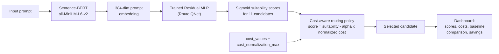
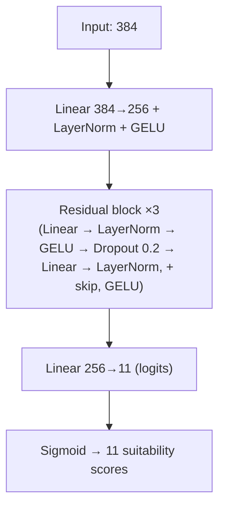
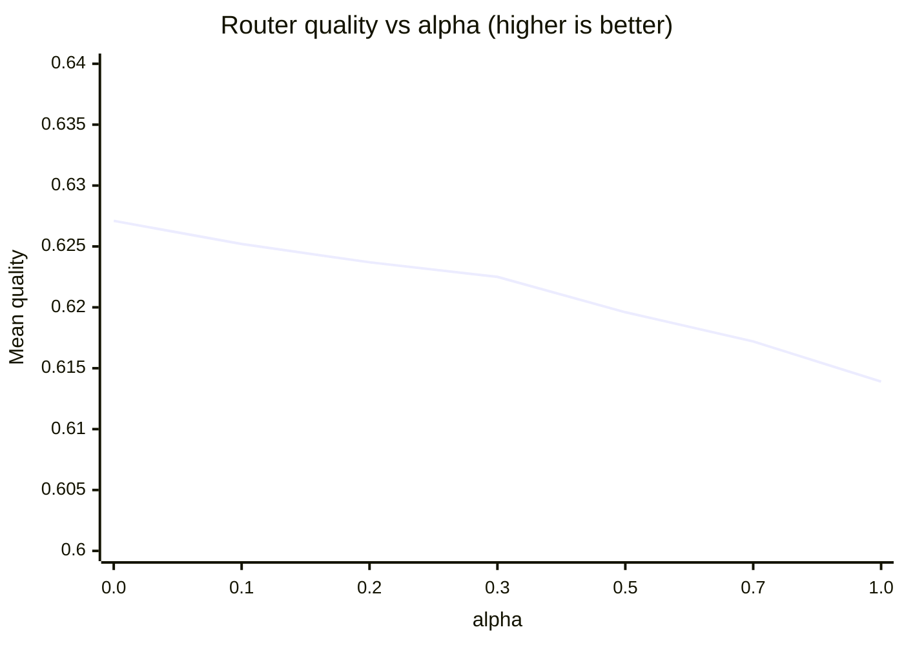
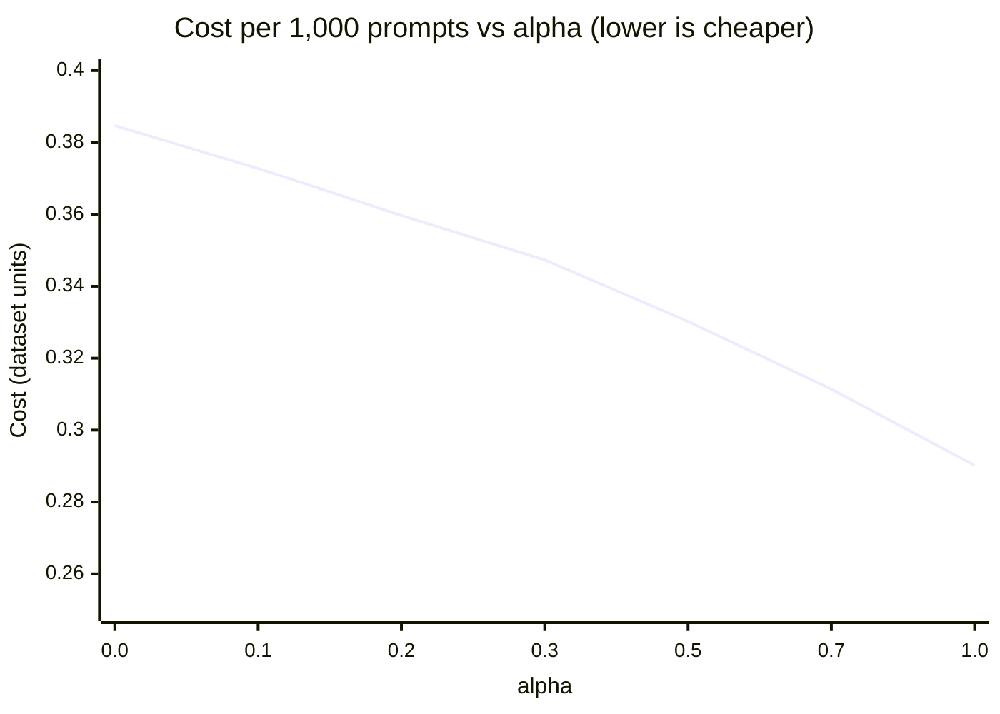

# RouteIQ — Cost-Aware LLM Routing System

RouteIQ is a cost-aware LLM routing system. Given a prompt, a trained **Residual MLP** predicts how suitable each of **11 candidate LLMs** is, and a configurable **cost penalty** is applied to pick the final candidate. A dark wine-red web dashboard shows the selected model, scores, estimated costs and savings against a baseline.

> **Scope:** the current application performs **model selection only**. It does **not** call the selected LLM and does **not** generate a response to the prompt.

---

## Live Demo / Video Demo

| Resource | Link |
|---|---|
| 🎥 **Demo video** | [Watch on Google Drive](https://drive.google.com/file/d/1Xdh1CRo1Aejy67GSjEUA7UYQjT1lq-7C/view?usp=sharing) |
|
> **Note:** the demo video shows the application **running locally**. A public cloud deployment is **not currently available**.

---

## Table of Contents

1. [Project Overview](#1-project-overview)
2. [Architecture](#2-architecture)
3. [Candidate Models](#3-candidate-models)
4. [Training Setup](#4-training-setup)
5. [Cost Efficiency, Routing Quality & Oracle Comparison](#5-cost-efficiency-routing-quality--oracle-comparison)
6. [Cost Configuration](#6-cost-configuration)
7. [Dashboard and API](#7-dashboard-and-api)
8. [Technology Stack](#8-technology-stack)
9. [Installation and Local Usage](#9-installation-and-local-usage)
10. [Limitations and Future Improvements](#10-limitations-and-future-improvements)
11. [Verification Notes](#11-verification-notes)
12. [Disclaimer](#12-disclaimer)

---

## 1. Project Overview

Calling the strongest LLM for every request is expensive, and many prompts do not need it. RouteIQ explores a cheaper alternative: **route each prompt to the candidate model that offers the best trade-off between predicted suitability and cost.**

How it works in one paragraph: the prompt is embedded with Sentence-BERT into a 384-dimensional vector. A Residual MLP, trained on the recorded quality scores of 11 LLMs from the [RouterBench](https://huggingface.co/datasets/withmartian/routerbench) dataset (`routerbench_0shot.pkl`), outputs one suitability score per candidate. A cost-aware policy subtracts a normalized cost penalty, scaled by a configurable `alpha`, and selects the highest-scoring candidate.

**What RouteIQ is not (yet):** it is not a gateway, it does not call provider APIs, and it does not return LLM answers.

---

## 2. Architecture



### Component roles

| Component | Role |
|---|---|
| **Sentence-BERT** (`sentence-transformers/all-MiniLM-L6-v2`) | Converts the prompt into a fixed 384-dimensional embedding. Embeddings are used as produced (not L2-normalized), matching training. |
| **Residual MLP (`RouteIQNet`)** | Maps the embedding to 11 logits; a sigmoid turns each logit into a per-candidate suitability score. |
| **Cost-aware routing policy** | Combines suitability with a normalized cost penalty and picks the arg-max candidate. |
| **Cost configuration** | `cost_values` (per candidate, in candidate order) and `cost_normalization_max` (fixed scaling constant). |
| **Flask backend + dashboard** | Serves the model and a UI for entering prompts and comparing candidates. |

### Routing objective

Verified against the evaluation code in the training notebook:

```text
suitability_score  = sigmoid(RouteIQNet(embedding))
normalized_cost    = cost / cost_normalization_max
routing_score      = suitability_score - alpha * normalized_cost
selected_model     = argmax(routing_score)   # candidates without a valid cost are excluded
```

- `alpha = 0` ignores cost entirely and routes on suitability only.
- Higher `alpha` penalizes expensive candidates more strongly.
- The suitability score is a sigmoid output, **not a calibrated probability** (the dashboard says so as well).

### Residual MLP architecture



---

## 3. Candidate Models

Candidates are indexed in the following **verified training order** (alphabetical, as produced by the training pipeline):

| # | Candidate model |
|--:|---|
| 1 | `WizardLM/WizardLM-13B-V1.2` |
| 2 | `claude-instant-v1` |
| 3 | `claude-v1` |
| 4 | `claude-v2` |
| 5 | `gpt-3.5-turbo-1106` |
| 6 | `gpt-4-1106-preview` |
| 7 | `meta/code-llama-instruct-34b-chat` |
| 8 | `meta/llama-2-70b-chat` |
| 9 | `mistralai/mistral-7b-chat` |
| 10 | `mistralai/mixtral-8x7b-chat` |
| 11 | `zero-one-ai/Yi-34B-Chat` |

### Why candidate ordering matters

The Residual MLP's output layer has 11 units, and **output unit *i* was trained to represent candidate *i*.** The model file stores no model names, so the position in the output vector is the only link between a score and a candidate. The same ordering must therefore be used for:

- the suitability outputs,
- the `cost_values` list,
- the candidate names shown in the UI.

If the order changes, scores and costs get attached to the wrong models and the router silently picks incorrectly, without raising an error.

---

## 4. Training Setup

Summarized from the training notebook.

| Item | Detail |
|---|---|
| Dataset | RouterBench 0-shot (`withmartian/routerbench`, `routerbench_0shot.pkl`), 11 models with both quality and cost columns |
| Features | 384-d Sentence-BERT embeddings of the prompt |
| Labels | Multi-hot: every model tied for the highest recorded quality on a prompt is marked positive |
| Loss | `BCEWithLogitsLoss` with per-candidate `pos_weight = negatives / max(positives, 1)` to handle class imbalance |
| Optimizer | AdamW, learning rate `1e-3`, weight decay `1e-4`, batch size 128 |
| Schedule | Up to 50 epochs, early stopping with patience 6, best-validation-loss checkpoint restored |
| Splits | 30% held-out test set (stratified, seed 42); remainder split 80/20 into train/validation |
| Test set size | 10,950 prompts |

---

## 5. Cost Efficiency, Routing Quality & Oracle Comparison

All results below come from RouteIQ's **held-out RouterBench test set of 10,950 prompts**. Quality and cost are the values **recorded in RouterBench** for whichever candidate the router selects. Costs are in the dataset's cost units, not live provider prices.

### Key results at the current configuration (alpha = 0.7)

| 💰 Recorded cost savings | 🎯 RouteIQ mean quality | 🏆 Fixed GPT-4 Turbo quality |
|:---:|:---:|:---:|
| **90.47%** vs always GPT-4 Turbo | **0.6172** | **0.7819** |

| 🔮 Oracle quality | 📉 Quality regret | 💵 Cost per 1,000 prompts |
|:---:|:---:|:---:|
| **0.9134** (offline upper bound) | **0.2962** vs oracle | **0.3114** RouteIQ vs **3.2683** fixed GPT-4 Turbo |

| Strategy | Mean Quality | Cost per 1,000 Prompts |
|---|---:|---:|
| RouteIQ (alpha 0.7) | 0.6172 | 0.3114 |
| Fixed GPT-4 Turbo (`gpt-4-1106-preview`) | 0.7819 | 3.2683 |
| Oracle (offline upper bound) | 0.9134 | not applicable |

### What these results mean

**RouteIQ is substantially more cost-efficient in this experiment.** It reduces recorded benchmark cost by approximately **90.47%** relative to always selecting GPT-4 Turbo (0.3114 versus 3.2683 per 1,000 prompts).

**That efficiency comes with lower quality.** RouteIQ's mean quality of **0.6172** is below GPT-4 Turbo's **0.7819** and far below the oracle's **0.9134**. RouteIQ should therefore **not** be described as preserving GPT-4-level quality. It is better read as a cost-efficiency result with a clear quality trade-off.

**What the oracle is.** The oracle is an **offline upper-bound reference**. For each prompt it selects the highest-quality candidate using the recorded benchmark outcomes. It is **not a deployable model-selection strategy**, because it relies on knowing the outcomes in advance.

**What the savings are.** The savings measure **recorded benchmark cost**. They are not guaranteed real-world savings and do not reflect live provider prices. RouteIQ currently **selects** a candidate model but does **not call** that model to generate an answer.

**Quality regret** is the mean per-prompt difference between oracle quality and router quality (0.9134 − 0.6172 = 0.2962 at alpha 0.7). Together with the gap to GPT-4 Turbo, it marks meaningful room for improvement in how well the router identifies suitable models.

### Complete alpha comparison

| Alpha | Router Quality | Oracle Quality | Quality Regret | Cost per 1,000 Prompts | Savings vs GPT-4 |
|---:|---:|---:|---:|---:|---:|
| 0.0 | 0.6271 | 0.9134 | 0.2863 | 0.3847 | 88.23% |
| 0.1 | 0.6252 | 0.9134 | 0.2882 | 0.3728 | 88.59% |
| 0.2 | 0.6237 | 0.9134 | 0.2897 | 0.3597 | 88.99% |
| 0.3 | 0.6225 | 0.9134 | 0.2908 | 0.3473 | 89.37% |
| 0.5 | 0.6196 | 0.9134 | 0.2938 | 0.3302 | 89.90% |
| **0.7** (current) | **0.6172** | 0.9134 | **0.2962** | **0.3114** | **90.47%** |
| 1.0 | 0.6139 | 0.9134 | 0.2995 | 0.2902 | 91.12% |

Every row was evaluated on the same 10,950 test prompts.

**Reading the trend.** Increasing alpha strengthens the cost penalty. In the observed evaluation, that **reduces routing cost** (0.3847 → 0.2902 per 1,000 prompts) and **increases savings** (88.23% → 91.12%), but it also **decreases router quality** (0.6271 → 0.6139) and **increases quality regret** (0.2863 → 0.2995).

**Choosing alpha.** Alpha = 0.7 is the **currently configured setting**. Alpha = 1.0 gives the **largest savings among the tested values**, at the cost of the lowest measured quality. Neither is universally optimal. The right value depends on how much quality loss is acceptable for a given budget.





### Interpretation and limitations

- **An engineering trade-off, not a free win.** Large cost reductions come with a quality gap versus GPT-4 Turbo and a large regret versus the oracle. Higher savings does not automatically mean better routing, because the savings figure ignores quality.
- **Alpha selection.** Alpha should ideally be chosen on **validation data** against an explicit quality or budget target, rather than picked from test-set results. The sweep above is reported on the test set for transparency, so treat it as descriptive.
- **Scope of evidence.** These measurements reflect this project's own evaluation on RouterBench. They are **not independent proof** of performance on arbitrary real-world prompts, and real latency, response quality and actual provider cost have not been evaluated.
- **Diagnostic finding (alpha = 0.7).** Code Llama 34B is selected most often (24.63%) even though it has the lowest mean quality among the individual candidates. Other shares: Mixtral 8x7B 18.28%, Yi-34B 16.61%, Llama 2 70B 15.44%, GPT-4 Turbo 12.54%, Mistral 7B 11.41%; the remaining candidates are each under 1%. This suggests the predicted suitability scores are not yet well aligned with actual candidate quality, which is a priority for future work (see [Limitations](#10-limitations-and-future-improvements)).

---

## 6. Cost Configuration

Three pieces of configuration must stay consistent between the model, backend and frontend:

| Setting | Purpose |
|---|---|
| `cost_values` | Per-candidate cost estimates, given **in candidate order** (Section 3). |
| Candidate ordering | Links each model output (and each cost) to the correct candidate. |
| `cost_normalization_max` | Scale constant dividing every cost so the penalty is comparable to a 0–1 suitability score. |

### Normalization constant

```text
cost_normalization_max = 0.04478999972343445
```

This value was calculated from the **training subset** (the maximum recorded cost in the training split). It must remain consistent with the model's training setup. Changing it changes the size of the penalty at a given `alpha`, so results will no longer match the reported evaluation.

### Frontend cost estimates

The frontend currently uses the following **mean observed cost** estimates, in candidate order:

| # | Candidate | Mean observed cost |
|--:|---|---:|
| 1 | WizardLM | `0.00007291440124390647` |
| 2 | Claude Instant | `0.00023293713456951082` |
| 3 | Claude v1 | `0.0021446552127599716` |
| 4 | Claude v2 | `0.002418604213744402` |
| 5 | GPT-3.5 Turbo | `0.0002432600304018706` |
| 6 | GPT-4 Turbo | `0.0032927526626735926` |
| 7 | Code Llama | `0.00017204870528075844` |
| 8 | Llama 2 70B | `0.0002026650181505829` |
| 9 | Mistral 7B | `0.000045724285882897675` |
| 10 | Mixtral 8x7B | `0.00013457989552989602` |
| 11 | Yi 34B | `0.00018552223627921194` |

These are **representative mean observed costs, not guaranteed per-prompt prices or live provider quotes.** Cost units and normalization must be consistent between frontend and backend: `cost_values` must be in the same units as the values used to derive `cost_normalization_max`, otherwise the penalty is mis-scaled.

### Worked example

From the demo video, a prompt routed to `claude-v2` shows suitability 0.763823 and an estimated cost of 0.002419:

```text
0.763823 - 0.7 × (0.002419 / 0.04479) ≈ 0.7260   # matches the displayed final routing score of 0.726024
```

---

## 7. Dashboard and API

### Dashboard

A dark wine-red single-page interface (HTML, CSS, JavaScript) served by Flask. Features:

- **Prompt input** (up to 20,000 characters) with a clear button and an explicit "routing only" notice
- **Selected model** with the active `alpha` and a "Residual MLP + Sentence-BERT" tag
- **Suitability score** (labelled as a sigmoid output, not a calibrated probability)
- **Final routing score** (suitability minus normalized cost penalty)
- **Estimated cost** of the selected candidate
- **Candidate cost ranking** among candidates with a supplied cost
- **Baseline cost comparison** via a baseline-model selector
- **Estimated savings** and absolute cost difference versus the chosen baseline
- **Per-candidate comparison table** with scores, costs and the selected candidate highlighted

Savings shown in the dashboard are estimates based on the supplied cost values, not live provider quotes.

### API endpoints

| Method | Endpoint | Description |
|---|---|---|
| `GET` | `/` | Serves the dashboard. |
| `GET` | `/health` | Health check for the service. |
| `GET` | `/models` | Returns the candidate models. |
| `POST` | `/route` | Routes a prompt and returns the selected candidate. |

> ⚠️ **The request and response examples below are illustrative.** They show the general shape of a routing call, not a verified copy of the Flask implementation. Field names must be checked against `app.py` before this section is treated as exact.

**Illustrative request**

```bash
curl -X POST http://127.0.0.1:5000/route \
  -H "Content-Type: application/json" \
  -d '{
        "prompt": "Solve this grade school math problem: ...",
        "cost_values": [0.0000729, 0.000233, 0.002145, 0.002419, 0.000243,
                        0.003293, 0.000172, 0.000203, 0.0000457, 0.000135, 0.000186]
      }'
```

**Illustrative response**

```json
{
  "selected_model": "claude-v2",
  "suitability_score": 0.763823,
  "routing_score": 0.726024,
  "estimated_cost": 0.002419,
  "alpha": 0.7,
  "candidates": [
    {
      "model": "claude-v2",
      "suitability_score": 0.763823,
      "routing_score": 0.726024,
      "cost": 0.002419
    }
  ]
}
```

The values above reuse numbers visible in the demo video; the field names and structure are placeholders.

---

## 8. Technology Stack

| Technology | Use |
|---|---|
| **Python** | Core language for training, backend and evaluation |
| **PyTorch** | Residual MLP definition, training and inference |
| **Sentence Transformers** | `all-MiniLM-L6-v2` prompt embeddings |
| **Flask** | Backend and API |
| **NumPy** | Score, cost and routing-policy computation |
| **HTML, CSS, JavaScript** | Dashboard frontend |
| **Google Colab** | Training and experimentation |
| **Git and GitHub** | Version control and hosting |

Technical choices:

- **Sentence-BERT (MiniLM)** gives compact 384-d embeddings that are cheap to compute, so routing adds little overhead compared with an LLM call.
- **A residual MLP with LayerNorm** is a small, fast model that can be trained on frozen embeddings; skip connections keep the 3-block network stable to train.
- **Multi-hot labels with positive weighting** reflect that several models can tie for the best quality on a prompt, and counter the imbalance in which models win.
- **A separate, post-hoc cost penalty** lets `alpha` change at inference time without retraining.

---

## 9. Installation and Local Usage

> The commands below are a typical layout. Adjust file names to match the repository.

```bash
# 1. Clone the repository
git clone [INSERT GITHUB REPOSITORY URL]
cd [REPOSITORY FOLDER]

# 2. Create and activate a virtual environment
python -m venv .venv
source .venv/bin/activate        # Windows: .venv\Scripts\activate

# 3. Install dependencies
pip install -r requirements.txt  # includes torch, sentence-transformers, flask, numpy

# 4. Start the application
python app.py
```

Then open `http://127.0.0.1:5000/` in a browser.

### Reproducibility checklist

- Keep the **candidate order** from Section 3.
- Load the trained weights with a network of identical shape: input 384, hidden 256, three residual blocks, 11 outputs.
- Use `sentence-transformers/all-MiniLM-L6-v2` **without embedding normalization**, as in training.
- Keep `cost_normalization_max = 0.04478999972343445` and cost values in the same units.
- To reproduce the evaluation, use the RouterBench 0-shot file, the stratified 30% test split with seed 42, and the `alpha` values in Section 5.

---

## 10. Limitations and Future Improvements

### Limitations

- **Routing only.** The app selects a model; it does not call it or return a generated answer.
- **Quality below the strongest single model.** At alpha 0.7, mean quality (0.6172) is below fixed GPT-4 (0.7819), and regret versus the oracle is 0.2962.
- **Suitability scores may be misaligned with quality.** Code Llama 34B is chosen most often despite the lowest mean quality among individual candidates; score calibration, class weighting, label construction and cost-penalty scale all need investigation.
- **Mean observed costs.** Frontend comparisons use mean costs from benchmark data, not prompt-specific estimates.
- **Estimated versus actual cost.** Real provider costs can differ because of current pricing, token counts, retries, and embedding or network overhead.
- **Ordering and configuration dependence.** A mismatch in candidate order, `cost_values` or `cost_normalization_max` silently produces wrong routing.
- **`alpha` tuning.** The sweep is reported on the test split; `alpha` should be selected on validation data.
- **No public deployment.** There is no deployed public API; the demo runs locally.
- **Not production-validated.** Real-world latency, response quality and actual cost have not been evaluated.

### Future work

- **Provider integrations** so the selected model can actually be called
- **Live pricing** pulled from provider sources
- **Prompt-level cost estimation** based on token counts instead of mean costs
- **Stronger routing evaluation**: baselines such as kNN and published RouterBench routers, calibration analysis, and leave-one-task-out generalization
- **Better quality-aware constraints**, for example a minimum quality target when choosing `alpha`
- **Latency tracking** per candidate
- **Deployment** with a documented, secured public API

---

## 11. Verification Notes

- Model architecture, training setup, routing formula, the `alpha` results table, the normalization constant and the 11-model order were checked against the project's training and evaluation notebooks.
- The dashboard description was checked against the demo video.
- The Flask source (`app.py`) and `requirements.txt` were **not** available when this README was written, so the endpoint list is taken from the project description, the API payloads are **illustrative**, and the install commands are a typical layout. Update these after checking the repository.
- The GPT-4 mean cost in the frontend list (0.003293) differs slightly from the test-split mean used in the evaluation notebook (0.003268). This is consistent with the frontend values being computed on a different subset, but it should be confirmed.

---

## 12. Disclaimer

All reported results come from this project's **own evaluation** on the RouterBench dataset using recorded quality and cost values. They are not independently verified, are not guaranteed to hold on other data, and do not represent live provider pricing or performance. RouteIQ is an experimental research project and is **not** production-ready. Savings figures describe recorded benchmark cost reductions, not guaranteed real-world savings.
